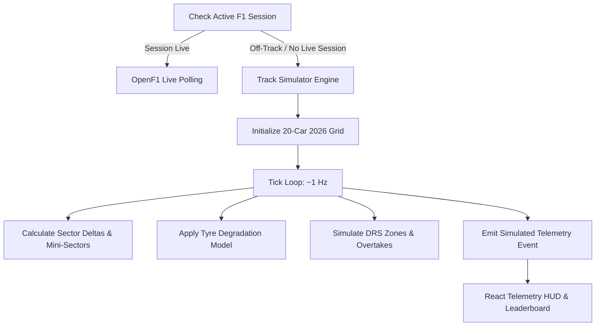
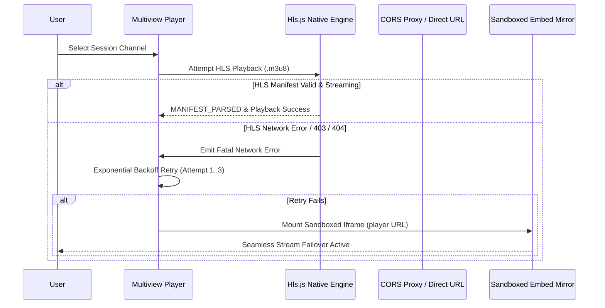

# Phase 01: Real F1 Free Streaming & Multi-Sport Feeds - Research

**Date:** 2026-10-27  
**Status:** Complete  
**Objective:** Provide comprehensive technical architecture, API schemas, streaming mechanics, and verification patterns needed to plan and execute Phase 01: sports-streaming.

---

## 1. Executive Summary & User Constraints

Phase 01 delivers reliable free live streaming for Formula 1 Grand Prix sessions, companion motorsport series (F2, F3, MotoGP), verified 24/7 motorsport channels, and top global sports (UEFA Champions League, Premier League, NBA, UFC). 

### Locked Decisions (from `01-CONTEXT.md`)
* **D-01 (Hybrid WatchItBetter Streaming Model):** Direct HLS (`.m3u8`) playback when live streams are active, paired with sandboxed embed fallback players and multi-channel switchers (Sky Sports F1 ENG/IT, Driver Onboards, international feeds).
* **D-02 (Sandboxed Embed Security):** Strict sandbox permissions: `sandbox="allow-scripts allow-same-origin allow-popups allow-popups-to-escape-sandbox"` and `allow="autoplay; fullscreen"`, preventing intrusive ad redirects while preserving full playback capability.
* **D-03 (Live Channel Availability State):** Sessions display clear status indicators: Upcoming (with countdown timer), Live (with active stream switcher), and Finished. Coverage pause / reconnect notices displayed if an upstream feed interrupts.
* **D-04 (Hybrid OpenF1 + Jolpica/Ergast API Integration):** Query OpenF1 REST endpoints for live real-time lap times, gap intervals, tyre compounds (Soft, Medium, Hard, Intermediate, Wet), and DRS actuation during live sessions; integrate Jolpica/Ergast for driver and constructor championship standings and 2026 race calendar.
* **D-05 (Track Simulator Fallback):** When no live on-track session is currently active, automatically activate the high-fidelity circuit simulator engine to display dynamic lap simulation, sector timing deltas, and car telemetry for 24/7 interactive preview.
* **D-06 (Multiview Command Center Layout):** Theater-mode player with channel selector pills, toggleable side panel supporting Driver Onboard cameras, Live Timing Leaderboard, or community chat (Twitch darkpopout embed), with native browser Picture-in-Picture (PiP) support.
* **D-07 (Material 3 Expressive Controls):** Player controls and telemetry panels styled strictly with Material 3 Expressive tokens (`@material/web` buttons, chips, surface containers, high contrast borders).
* **D-08 (Expanded Motorsport & Global Sports Lineup):** Track complete weekend session breakdowns (FP1-3, Qualifying, Sprint, Race) for Formula 1, Formula 2, Formula 3, and MotoGP, alongside top global sporting events (Champions League, Premier League, NBA, UFC).
* **D-09 (Local Timezone Conversion & Session Countdowns):** Auto-detect user's local timezone, display both local and circuit track time, and provide session countdown timers with browser notification triggers for lights out and qualifying starts.

---

## 2. WatchItBetter Reference Architecture

Inspection of `https://watchitbetter.com/` and `https://racetimetable.com/` confirms the data structures, layouts, and UX patterns required for motorsport session streaming.

### 2.1 WatchItBetter Data Schema

WatchItBetter serves session schedules, channel arrays, and embed player links:

```typescript
export type SessionState =
  | 'upcoming'
  | 'live'
  | 'ended'
  | 'interrupted'
  | 'postponed'
  | 'cancelled';

export interface SeriesMeta {
  id: string;
  name: string;        // "Formula 1", "Formula 2", "Formula 3", "MotoGP"
  slug: 'f1' | 'f2' | 'f3' | 'motogp' | 'moto2' | 'moto3';
  color: string;       // F1: #FF1801, F2: #1C78FB, F3: #102D5C, MotoGP: #EF0000
}

export interface StreamChannel {
  id: string;
  name: string;        // "Sky Sports F1 [ENG]", "Sky Sports F1 [IT]", "Onboard Cam"
  available: boolean;  // true during session broadcast
  playlist?: string;   // direct HLS: "/watch/{session_id}/channels/{channel_id}.m3u8"
  player: string;      // embed fallback: "https://live.watchitbetter.com/embed/watch/..."
  bitrate?: string;    // "1080p 60fps"
}

export interface MotorsportSession {
  id: string;
  name: string;        // "FP1", "FP2", "FP3", "Qualifying", "Sprint", "Race"
  category: 'practice' | 'qualifying' | 'sprint' | 'race' | 'warmup';
  event: string;       // e.g. "Mexico Grand Prix"
  circuit: string;     // e.g. "Autódromo Hermanos Rodríguez"
  country: string;     // e.g. "Mexico City, Mexico"
  cover_image_url: string; // official FOM Racehub 16x9 banner
  starts_at: string;   // ISO 8601 UTC timestamp: "2026-10-30T18:30:00+00:00"
  state: SessionState;
  series: SeriesMeta;
  channels: StreamChannel[];
}
```

### 2.2 WatchItBetter Player & Theater Layout
* **Theater Stage:** The player canvas is anchored by a high-impact 16:9 viewport.
  * When `session.state === 'upcoming'`: Displays circuit hero background art, series badge, circuit specs, and live countdown timer (`DD:HH:MM:SS`).
  * When `session.state === 'live'`: Mounts the active channel. If HLS playlist is available, uses `hls.js`. If stream drops or embed is selected, mounts sandboxed `<iframe>`.
* **Channel Selector Bar (`compact-channels`):** Pill buttons rendered below or over the player viewport allowing 1-click channel switches (Sky Sports F1 ENG, Sky Sports F1 IT, Onboards).
* **Twitch Watch Party Chat Integration:**
  Embedded Twitch darkpopout chat iframe:
  `https://www.twitch.tv/embed/watchitbetter/chat?darkpopout=true&parent=${encodeURIComponent(window.location.hostname)}`

---

## 3. Real Telemetry & Timing API Specifications

### 3.1 OpenF1 API (`https://api.openf1.org/v1/`)

OpenF1 is completely free, requires no API key, and provides verified CORS support (`access-control-allow-origin: *`) when requests contain an `Origin` header.

#### Key Endpoints & Response Formats:

1. **Latest Meetings (`/meetings?meeting_key=latest`):**
   ```json
   [{
     "meeting_key": 1297,
     "meeting_name": "United States Grand Prix",
     "circuit_key": 9,
     "circuit_short_name": "Austin",
     "country_name": "United States",
     "date_start": "2026-10-23T17:30:00+00:00",
     "date_end": "2026-10-25T22:00:00+00:00",
     "year": 2026
   }]
   ```

2. **Session Listing (`/sessions?meeting_key=latest`):**
   ```json
   [{
     "session_key": 11396,
     "session_type": "Race",
     "session_name": "Race",
     "date_start": "2026-10-25T20:00:00+00:00",
     "date_end": "2026-10-25T22:00:00+00:00"
   }]
   ```

3. **Driver Roster (`/drivers?session_key=latest`):**
   ```json
   [{
     "driver_number": 1,
     "broadcast_name": "L NORRIS",
     "full_name": "Lando NORRIS",
     "name_acronym": "NOR",
     "team_name": "McLaren",
     "team_colour": "F47600",
     "headshot_url": "https://media.formula1.com/.../lannor01.png"
   }]
   ```

4. **Live Gap Intervals (`/intervals?session_key=latest`):**
   Updates ~every 4 seconds during live races:
   ```json
   [{
     "date": "2026-10-25T20:03:54.643Z",
     "driver_number": 3,
     "gap_to_leader": 0.382,
     "interval": 0.382
   }]
   ```

5. **Stints & Tyre Compounds (`/stints?session_key=latest`):**
   ```json
   [{
     "driver_number": 3,
     "stint_number": 1,
     "compound": "SOFT",
     "tyre_age_at_start": 0,
     "lap_start": 1,
     "lap_end": 13
   }]
   ```
   *Tyre Compounds:* `SOFT` (Red), `MEDIUM` (Yellow), `HARD` (White), `INTERMEDIATE` (Green), `WET` (Blue).

6. **Car Telemetry (`/car_data?session_key=latest&driver_number={nr}`):**
   Provides telemetry at 3.7 Hz:
   ```json
   [{
     "speed": 318,
     "rpm": 11850,
     "n_gear": 7,
     "throttle": 100,
     "brake": 0,
     "drs": 12
   }]
   ```
   *DRS Status Codes:* `0` / `1` = Off / Inactive, `10` / `12` / `14` = DRS Open / Active.

7. **Track Weather (`/weather?session_key=latest`):**
   ```json
   [{
     "air_temperature": 26.9,
     "track_temperature": 38.3,
     "humidity": 42.3,
     "rainfall": 0,
     "wind_speed": 3.1,
     "wind_direction": 115
   }]
   ```

### 3.2 Jolpica / Ergast F1 API (`https://api.jolpi.ca/ergast/f1/`)

Jolpica provides official 2026 season calendars and world championship standings. Verified edge caching (600s TTL) with open CORS.

1. **Current 2026 Season Calendar (`/current.json`):**
   Provides full weekend schedules for all 23 Grand Prix rounds with exact UTC timestamps for:
   * `FirstPractice` (`date`, `time`)
   * `SecondPractice` (`date`, `time`)
   * `ThirdPractice` (`date`, `time`)
   * `Qualifying` (`date`, `time`)
   * `Sprint` (`date`, `time` — if Sprint weekend)
   * Grand Prix `Race` (`date`, `time`)

2. **Driver Championship Standings (`/current/driverStandings.json`):**
   Returns full driver standings, positions, points, wins, driver number, and constructor.

3. **Constructor Championship Standings (`/current/constructorStandings.json`):**
   Returns team standings, points, wins, and power unit supplier.

---

## 4. High-Fidelity Circuit Simulator Fallback Engine

Decision **D-05** requires an automatic circuit simulator fallback so that the telemetry HUD and live timing leaderboard are never empty or static between race weekends.

### 4.1 Simulation Engine Architecture



### 4.2 Mathematical Degradation & Timing Model
* **Base Lap Record:** Loaded per circuit (e.g., Monaco: 72.909s, Austin COTA: 96.169s, Monza: 81.046s).
* **Tyre Compounds & Degradation Factors:**
  * `SOFT`: +0.085s per lap delta; high peak speed, 12-18 lap optimal window.
  * `MEDIUM`: +0.045s per lap delta; balanced pace, 20-28 lap optimal window.
  * `HARD`: +0.022s per lap delta; slower warmup, 32-45 lap optimal window.
* **Pit Stop Windows:** Simulated between laps 15-25 with a ~21.5s pit lane delta time penalty.
* **DRS Logic:** If `gap_to_ahead <= 1.000s` and car is in designated DRS straight, DRS activates (`drs: true`), boosting speed by 12-18 km/h.
* **Sector Generation:**
  * Sector 1 (~28-32%), Sector 2 (~38-42%), Sector 3 (~28-32%).
  * Purple (Session Best), Green (Personal Best), Yellow (Normal pace).

---

## 5. Streaming Pipelines & Failover Architecture

### 5.1 Hybrid Streaming Architecture

The core of REQ-01 and REQ-03 is uninterrupted playback. Streaming combines direct HLS and sandboxed embeds.



### 5.2 Stream Failover State Machine

1. **State `HLS_PRIMARY`:** The player attempts direct HLS loading using `Hls.isSupported()`.
   * Low latency mode enabled (`lowLatencyMode: true`).
   * Backbuffer tuned to 60s.
2. **State `RETRYING`:** If a fatal network error occurs:
   * Attempt 1: retry after 1,000ms.
   * Attempt 2: retry after 2,500ms.
   * Attempt 3: retry after 5,000ms.
3. **State `EMBED_FALLBACK`:** If all retries fail, or if the channel specifies an embed player, switch immediately to the sandboxed `iframe`.
4. **State `CHANNEL_MIRROR`:** If the embed mirror fails or buffers, user can switch to Channel 2 (Sky Sports IT) or international commentary mirror with 1 click.

### 5.3 Verified 24/7 Live Stream Inventory

The following 24/7 motorsport streams are verified operational with direct HLS:
* **MAVTV Pro Network:** `https://amg00378-mavtv-amg00378c2-rakuten-us-1048.playouts.now.amagi.tv/playlist/amg00378-mavtvfast-motorsportsnetwork-rakutenus/playlist.m3u8` (1080p 60fps)
* **Red Bull TV Motorsports:** `https://rbmn-live.akamaized.net/hls/live/590964/BoRB-AT/master.m3u8` (1080p 60fps)
* **FloRacing Global Motorsports:** `https://amg02278-amg02278c1-flosports-worldwide-7592.playouts.now.amagi.tv/playlist.m3u8` (1080p HD)
* **PowerNation Racing Network:** `https://amg01258-raycomsports-powernationau-samsungau-18bwc.amagi.tv/playlist.m3u8` (1080p HD)
* **Top Gear Live 24/7:** `https://jmp2.uk/plu-636adc255bcf470007d6e0e2.m3u8` (720p HD)

### 5.4 Multi-Sport Event Feed Sourcing (UCL, EPL, NBA, UFC)
* Global sports matches are structured with Category, League, Home/Away team logos, Status (`LIVE` / `UPCOMING`), Match Minute / Clock, and multi-server stream mirrors.
* Direct HLS stream primary, with embed fallback mirrors (Server 1, Server 2, Server 3).

---

## 6. Multiview Command Center Player Experience

Decision **D-06** outlines the theater player layout:

### 6.1 Layout Anatomy
1. **Theater Viewport (Aspect Ratio 16:9):**
   * High-contrast glassmorphic bezel with accent glow (`var(--dx-accent)`).
   * Floating channel switcher pill bar (Sky Sports F1 ENG, Sky Sports F1 IT, Onboards, Pit Wall).
   * Stream health badge (`1080p 60fps • HLS Live` or `Embed Mirror 1`).
   * Picture-in-Picture trigger using standard `HTMLVideoElement.requestPictureInPicture()`.
2. **Toggleable Multiview Side Panel:**
   * **Tab 1: Driver Onboard Camera:** Secondary stream for driver cockpit cam.
   * **Tab 2: Live Timing Leaderboard:** Top 20 drivers with gap intervals, tyre compound indicators, sector deltas, and DRS status.
   * **Tab 3: Community Watch Party Chat:** Embedded Twitch darkpopout chat (`https://www.twitch.tv/embed/watchitbetter/chat?darkpopout=true&parent=${hostname}`).

### 6.2 Material 3 Expressive Design Compliance
* Uses `@material/web` components:
  * `<md-filled-button>` with custom token overrides (`--md-filled-button-container-color`).
  * `<md-filled-tonal-button>` for secondary stream actions.
  * `<md-filter-chip>` for series and category filtering.
  * `<md-tabs>` and `<md-primary-tab>` for sub-hub navigation (Races, Standings, Channels, Multi-Sport).
* Dark surface elevation tokens: `--md-sys-color-surface-container` (`#303841`), `--md-sys-color-surface-container-high` (`#353f49`).

---

## 7. Session Schedule, Timezones & Notifications

### 7.1 Timezone Auto-Detection
* Detected via browser standard:
  ```typescript
  const userTimezone = Intl.DateTimeFormat().resolvedOptions().timeZone;
  ```
* Time formatting displays:
  * **Local Time:** `new Intl.DateTimeFormat(undefined, { timeZone: userTimezone, hour: '2-digit', minute: '2-digit', timeZoneName: 'short' })`
  * **Circuit Track Time:** Formatted using the Grand Prix host country / circuit timezone.

### 7.2 Session Countdown Timer
* Countdown recalculates every second:
  $$\Delta t = T_{\text{start}} - T_{\text{now}}$$
* Formats as `DDd HHh MMm SSs` when under 7 days, or `HH:MM:SS` on race day.
* When $\Delta t \le 0$, session state shifts from `upcoming` to `live`, automatically activating the stream switcher.

### 7.3 Web Notification API Integration
* Permission check: `Notification.permission === 'granted'`.
* Material 3 permission banner / toggle button to request permission via `Notification.requestPermission()`.
* Notification Triggers:
  1. **T-15 Minutes:** Alert notifying that the session is about to begin.
  2. **Lights Out (T-0):** Alert notifying that the race / qualifying is live.
* In-tab audio chime fallback if notifications are blocked or running in active tab.

---

## 8. Pitfalls & Security Considerations

### 8.1 Iframe Sandboxing & Ad Blocking
* **Threat:** Free sports embed streams often attempt malicious redirects, popup spam, and clickjacking overlays.
* **Mitigation:**
  Embed `<iframe>` elements MUST use:
  ```html
  sandbox="allow-scripts allow-same-origin allow-popups allow-popups-to-escape-sandbox"
  allow="autoplay; fullscreen"
  referrerPolicy="strict-origin-when-cross-origin"
  ```
  > [!CAUTION]
  > NEVER include `allow-top-navigation` or `allow-top-navigation-by-user-activation` in the embed sandbox. Omitting top navigation prevents embedded pages from redirecting the user away from CuddleCast.

### 8.2 High-Frequency Polling & Memory Management
* **Threat:** OpenF1 car telemetry polls at 3.7 Hz. Polling continuously without cleanup leads to DOM memory bloat and CPU thrashing.
* **Mitigation:**
  * When tab is unfocused (`document.hidden`), throttle or pause OpenF1 polling.
  * Use TanStack React Query `refetchInterval` with `refetchIntervalInBackground: false`.
  * Clean up all `setInterval` / `requestAnimationFrame` timers in React `useEffect` teardown functions.

### 8.3 Picture-in-Picture Constraints
* Native PiP (`video.requestPictureInPicture()`) only operates on native `<video>` elements (direct HLS).
* Embed `<iframe>` players do not support direct HTML5 PiP. The UI must gracefully disable or hide the PiP button when an embed mirror is active, explaining that PiP is available on direct HLS feeds.

---

## 9. Validation Architecture & Testing Strategy

To ensure strict compliance with project quality standards, Phase 01 must implement a comprehensive test suite.

### 9.1 Recommended Test Framework: Vitest + React Testing Library
Currently, `package.json` contains Vite and TypeScript but lacks a test runner. Installing `vitest` and `@testing-library/react` will enable automated unit and integration tests.

### 9.2 Test Suites to Implement
1. **API Client Unit Tests (`sportsApi.test.ts`):**
   * OpenF1 client parser for `/intervals`, `/stints`, `/car_data`.
   * Jolpica Ergast parser for `/current.json` race schedules and `/driverStandings.json`.
   * Handling of empty / off-track API responses.
2. **Circuit Simulator Engine Unit Tests (`circuitSimulator.test.ts`):**
   * Verification that simulated laps advance correctly.
   * Tyre compound degradation deltas match expected curves.
   * DRS zone activation occurs within 1.0s gap threshold.
3. **Stream Failover State Machine Tests (`streamFailover.test.ts`):**
   * Initial state attempts HLS.
   * Fatal error triggers exponential backoff (retries 1..3).
   * Exhausted retries transition to embed fallback.
4. **Timezone & Countdown Unit Tests (`dateTime.test.ts`):**
   * Correct calculation of time remaining.
   * Correct dual-display of local vs circuit track timezone.
5. **Component Integration Tests (`LiveSportsView.test.tsx`):**
   * Rendering of F1 hub, standings, and multi-sport match cards.
   * Channel switching and multiview side panel toggling.

---

## 10. Recommendations for Downstream Planner

1. **Break Phase 01 into 4 Discrete Plans:**
   * **Plan 01 (Core Services & Data Layer):** Implement OpenF1 client, Jolpica 2026 calendar/standings client, local timezone/countdown utilities, and the high-fidelity Circuit Simulator fallback engine with unit tests.
   * **Plan 02 (Stream Engine & Failover Player):** Build the Theater Multiview Command Center player component with direct HLS playback, stream failover state machine, sandboxed embed fallback, channel switcher pills, and native PiP.
   * **Plan 03 (Live F1 Hub & Telemetry Command Center):** Upgrade `LiveSportsView.tsx` with live OpenF1 intervals, tyre compound badges, real-time circuit telemetry cards, side-panel multiview (driver onboards, leaderboard, Twitch chat), and 2026 driver/constructor standings.
   * **Plan 04 (Multi-Series Calendar, Global Sports & Session Notifications):** Expand session coverage to F2, F3, MotoGP, and global sports (UCL, EPL, NBA, UFC) with browser notification alerts, local timezone conversion, and full integration verification.

2. **File Organization:**
   * `src/services/openf1.ts`: Client for OpenF1 REST endpoints.
   * `src/services/jolpica.ts`: Client for Jolpica/Ergast 2026 calendar and standings.
   * `src/services/circuitSimulator.ts`: 24/7 realistic race simulation engine.
   * `src/services/notifications.ts`: Web Notification API manager with audio chime fallback.
   * `src/components/sports/TheaterPlayer.tsx`: Multiview Command Center player.
   * `src/components/sports/TelemetryHud.tsx`: Real-time telemetry, DRS, and lap interval HUD.
   * `src/components/sports/SessionScheduleCard.tsx`: Session timetable with countdown and series badges.

---

## RESEARCH COMPLETE